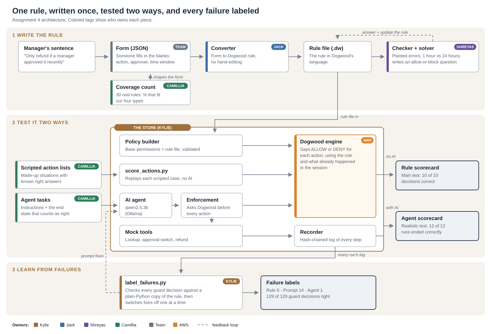

# Agent Guardrail Testbed (the "store")

A local model runs refund and deploy tasks against mock tools. Every tool call goes through Dogwood before it runs. Every step is recorded Provenance-style in `.provenance/`. Any rule file in Dogwood format can be loaded and scored two ways: with the agent, and without it.

```
                     rule file (.dw)  +  policies/base.dw
                                   |
model (Ollama) -> agent.py -> enforce.py -> dogwood replay -> ALLOW / DENY
                                   |                             |
                             recorder.py  <-------- every step logged

scripted action lists -> score_actions.py -> enforce.py -> dogwood replay -> rule scorecard
```

| File | What it does |
|---|---|
| `tools.py` | Mock refund and deploy tools with fake orders. Includes the **approval switch**: the pretend manager says yes, no, or approves a different amount. |
| `agent.py` | The loop: the model picks a tool, the gate checks it, the tool runs or is blocked. |
| `enforce.py` | The thin layer. Builds the policy (base + rule file), turns each call into a Dogwood trace event, and asks `dogwood replay` for a verdict. Fails closed. |
| `recorder.py` | Provenance-style recorder: local only, plain text, hash-chained so edits show up. |
| `run_task.py` | Runs agent tasks from a task file against a rule file, then writes an **agent scorecard**. |
| `score_actions.py` | Runs scripted action lists (no agent) against a rule file, then writes a **rule scorecard**. |
| `review.py` | Checks a session's hash chain and prints its timeline. |
| `label_failures.py` | Part 4: labels every failed agent run as a rule, prompt or agent failure. |
| `policies/schema.cedarschema` | The store's tools, as Dogwood sees them. Rule files must use these names. |
| `policies/base.dw` | Permissions the store always loads (lookup, approval requests, tests, rollback). |
| `rules/` | Rule files under test. `refund_recent_approval.dw` is the Assignment 4 rule; `starter.dw` is the Assignment 3 set. |
| `tasks/refund_tasks.json` | Agent tasks with the expected end state (draft format). |
| `tests/refund_recent_approval_actions.json` | Sample scripted action lists with known right answers (draft format). |

## Setup (Windows)

1. **Python 3.10+.** Standard library only.
2. **Ollama.** `ollama pull qwen2.5:3b` (what we used). `qwen2.5:7b` follows instructions better.
3. **Dogwood CLI** (what worked for us):
   ```
   winget install Rustlang.Rust.GNU
   winget install BrechtSanders.WinLibs.POSIX.UCRT
   git clone --depth 1 https://github.com/dogwood-policy/dogwood
   cd dogwood
   cargo build --release -p dogwood-cli
   ```
   Then: `$env:DOGWOOD_CMD = "<path>\dogwood\target\release\dogwood.exe"`

## Run

```
# One refund with the agent (approval switch: yes | no | different)
python run_task.py --task refund_approved
python run_task.py --task refund_approved --approval different --different-amount 25

# Score a rule file with the agent: every task, 3 runs each
python run_task.py --rules rules/refund_recent_approval.dw --all --runs 3

# Score a rule file without the agent (main test)
python score_actions.py tests/refund_recent_approval_actions.json --rules rules/refund_recent_approval.dw

# Review a run
python review.py
```

`--model scripted` replays a fixed script instead of a model, for testing the plumbing. Logs mark these runs as scripted.

## Formats (drafts, agree as a team)

**Rule file:** a Dogwood `.dw` file using the tool names in `policies/schema.cedarschema` (for example `Shop::Action::"IssueRefund"`, with `context.input.order_id` and `context.input.amount`). The store adds `policies/base.dw` in front of it and saves the combined policy in each session folder.

**Task file:** `{"tasks": [{"id", "prompt", "approval", "different_amount"?, "expect": {"refunds": [{"order_id", "amount"}]}}]}`. A run passes if the store ends up exactly as `expect` says.

**Action list:** `{"cases": [{"id", "events": [{"at": "30m", "tool", "kind": "request"|"response", "input", "output"?, "expect": "ALLOW"|"DENY"?}]}]}`. Each case is a fresh history; only requests with `expect` are scored.

## The record

Each agent run writes `.provenance/session-<time>/`:

- `events.jsonl`: every step, hash-chained. This is the proof.
- `timeline.txt`: the same steps, readable.
- `policy.dw`: the exact rules enforced in that run.
- `trace.log`: the history Dogwood saw, so `dogwood replay` can re-check the run.

Scorecards go to `results/`. The `failure_label` column is filled in for Part 4 (rule, prompt, or agent).

## Design notes

- **Blocks name the missing rule.** A denial tells the agent which rule would allow the action.
- **One nudge, only after a block.** If the agent stops to ask a human right after being blocked, it is told once that no human will reply.
- **Refund means a refund_id.** The prompt says a refund only happens when `issue_refund` returns a refund_id (added after Assignment 3 Run 4, where the agent claimed a refund it never made).
- **Fail closed.** If Dogwood errors or returns no verdict, the action is blocked.

## Architecture



## Part 4: failure labels

```
python label_failures.py                       # labels .provenance/, writes the report there
python label_failures.py RUN_FOLDER --out DIR  # any run folder; --out defaults to RUN_FOLDER
```

Reads every session in the run folder and writes `failure_labels.md` (and `.json`) next to them, never into `results/` unless `--out results` is given. For each failed agent run:

1. **Rule check.** Every guard decision is compared with a plain-Python copy of the rule (written separately from Dogwood). Any disagreement is a **rule failure**.
2. **Prompt check.** If every decision was right, it finds the fix for what went wrong and looks at runs made with that fix on, in the same situation. If the failure never came back in 3 or more of them, it is a **prompt failure**.
3. Otherwise it is an **agent failure**.

It also re-scores runs against the right expected result, flags passes where the agent did nothing, and prints a controlled-test table.

**Switches for controlled tests** (turn one fix off at a time):

| Flag | Turns off |
|---|---|
| `--prompt a3` | The lines "a refund only counts with a refund_id" and the approved-amount lines |
| `--prompt a3-original` | The above, plus the "work alone, never ask the user" lines |
| `--no-nudge` | The one-time reminder after a block |
| `--no-repair` | The "your last reply was not a valid tool call" message |
| `--prompt current-amount` | Adds "ask for exactly the amount the task needs" (fixes the $500 failure) |

## Results

- Assignment 3: [`results/refund_run_logs.md`](results/refund_run_logs.md).
- Assignment 4, rule scored without the agent (10 of 10): [`results/rule_scorecard_20261021-203602.md`](results/rule_scorecard_20261021-203602.md).
- Assignment 4, rule scored with the agent (12 of 12): [`results/agent_scorecard_20261021-211011.md`](results/agent_scorecard_20261021-211011.md).
- Assignment 4, Part 4 failure labels (rule 0, prompt 14, agent 1): [`results/failure_labels.md`](results/failure_labels.md).
